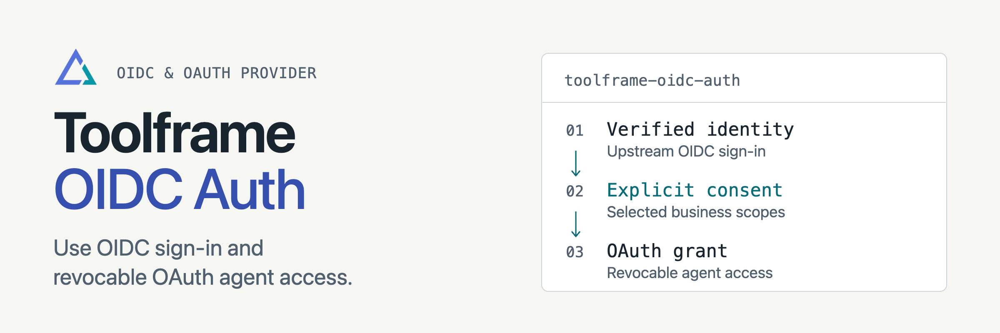

<p align="center">
<picture>
  <source media="(prefers-color-scheme: dark)" srcset="docs/assets/readme-banner-dark.png">
  <source media="(prefers-color-scheme: light)" srcset="docs/assets/readme-banner-light.png">
  
</picture>
</p>

# Toolframe OIDC Auth

[](https://github.com/toolframe/toolframe-oidc-auth/actions/workflows/ci.yml?query=branch%3Amain)

Use an OIDC identity for sign-in and issue separate, revocable OAuth grants to agents.
Toolframe Auth owns local users and permissions; MCP Auth verifies the resulting app tokens.

## Quick start

Use Python 3.14+, SDK 0.4+ and compatible Core, Auth, Dashboard Auth and MCP Auth
packages. Follow [OIDC setup](docs/setup.md) to register an upstream client, store
its secret, configure the canonical HTTPS URL and allow exact issuer/subject
identities in `APP/toolframe.toml`. Then apply the complete configuration:

```sh
toolframe --home APP apply
```

Core installs `toolframe-oidc-auth` from the declared package source. Sign in,
then give an OAuth-capable agent your app's `https://YOUR_HOST/mcp` URL to begin
consent. The required provider settings must be present before installation.

**Support:** public OAuth clients, authorization code with PKCE S256, rotating
refresh tokens, static registration and bounded dynamic registration. Google and
Keycloak use the generic adapter; deployment-specific live checks are required.
The [TinyAuth fixture](examples/tinyauth/README.md) provides a reproducible local flow.

**Recovery:** retain Auth/OIDC stores and private keys together. Agent grants are
independent of browser sessions; signing out does not revoke them.

## Guides

| I want to… | Start here |
| --- | --- |
| Configure providers and admission | [OIDC setup](docs/setup.md) |
| Connect or revoke agents | [OAuth and recovery](docs/oauth.md) |
| Manage registration capacity | [Registration](docs/registration.md) |
| Contribute or run checks | [Contributing](CONTRIBUTING.md) · [Verification](docs/development.md) |
| Publish a package | [Releasing](docs/releasing.md) |

[Releases](https://github.com/toolframe/toolframe-oidc-auth/releases)

## License

[Apache 2.0](LICENSE), with [NOTICE](NOTICE).
